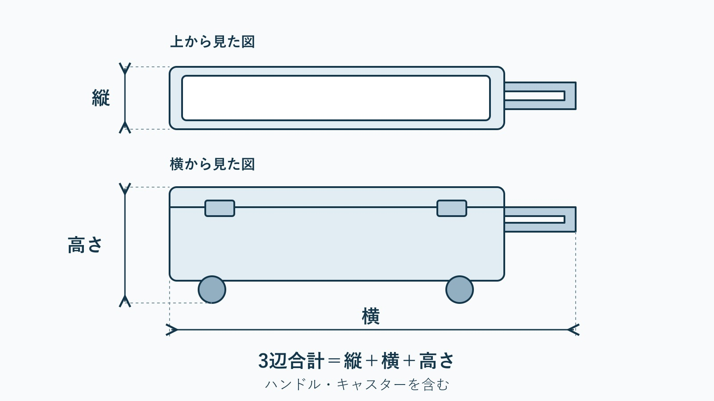

import TackleCard from "~/components/common/TackleCard.astro";

{/* cover prompt: High-end hyper-realistic editorial photograph of a clean closed unbranded long fishing cooler box strapped securely for shipping on a tidy wooden preparation bench, a plain blank shipping tag without marks, wooden pontoons and square fishing pens in a calm sheltered bay softly blurred in the background, soft cinematic daylight, exact 16:9 landscape, no text, no letters, no logos, no people. */}

遠征先で魚が釣れたあと、大きなクーラーと旅行かばんを一緒に持って駅へ向かう。その荷物を想像すると、クーラーを持参するかどうかを釣行前に決める理由が見えてきます。

<strong>車なら積載、電車なら運べる荷物量、飛行機なら航空券の手荷物条件</strong>から考えましょう。魚を家へ送るなら、クーラーを持たずに出発する方法もあります。

この記事は遠征での運び方と規定を扱います。魚種に合う容量や保冷力は、[クーラーボックスの容量・保冷力の選び方](/tactics/gear/cooler-box-selection/)へ進んでください。

## 遠征タイプ別に、持参・現地調達・配送を選ぶ

| 状況 | 選択肢 | 出発前の確認 |
| :--- | :--- | :--- |
| 車で往復する | 自分のクーラーを積む | 車の開口部と荷室、魚・氷を入れた重さ |
| 新幹線などで移動する | 持てる容器に絞るか、魚を送る | 鉄道会社の手荷物規則と、混雑時の扱い |
| 飛行機で移動する | 預けるか、現地で箱を手配する | 運賃ごとの許容量、機種、漏水防止の条件 |
| クーラーを持っていない | 現地購入・施設の発泡スチロールセット・配送 | 店の在庫、施設の対応、帰りの運び方 |

<strong>帰路の荷物→容器→魚の処理と保冷</strong>の順に決めると、現地で箱がなくて困る場面を減らせます。

「電車なら何Lまで」と一律には決められません。同じ容量でも外寸や自重は違い、魚と氷を入れたときの負担も変わります。

## クーラーなしで来る人には、現地での3つの選択肢がある

### 現地で買うなら、店と帰路の両方を決める

釣具店で買う場合は、営業開始時刻と在庫を確認します。早朝の受付前に買えるとは限りません。

釣りのあとに買う計画なら、それまで魚を保冷する容器も必要です。購入後に電車や飛行機で運べる外寸かも確かめてください。

### 施設の発泡スチロールセットは、含まれる作業を聞く

箱と氷の購入だけか、魚の処理や梱包まで頼めるかを分けて聞きます。

発泡スチロールがあっても宅配の受付があるとは限りません。自分で持ち帰るのか、発送するのかを伝えて相談しましょう。

### 魚を配送するなら、自分の帰宅日と合わせる

大物を持って観光や乗り換えをする代わりに、魚を送って帰る方法です。

ただし、クール便の上限に収まる箱と、発送前の予冷が必要です。受け取れる日時まで決めてから釣行を予約します。

[釣った魚の配送ガイド](/column/travel/fish-shipping-guide/)で、箱の用意・料金・発送・受け取りを確認してください。

## 宅配便の3辺合計は、通常便とクール便を分けて見る

空のクーラーを釣り場へ送る場合と、魚を入れて冷蔵で送る場合では、使えるサービスが異なります。

| サービス | 3辺合計 | 重量 | 遠征での使い方 |
| :--- | :--- | :--- | :--- |
| ヤマト・宅急便 | 200cm以内 | 30kg以内 | 空のクーラーなどの道具 |
| ヤマト・クール宅急便 | 120cm以内 | 15kg以内 | 予冷した魚。通常便の上限を当てはめない |
| 佐川・飛脚宅配便 | 160cm以内 | 30kg以内 | 規格に収まる道具 |
| 佐川・飛脚ラージサイズ宅配便 | 260cm以内 | 50kg以内 | 大型の道具。クール便とは別 |
| 佐川・飛脚クール便 | 140cm以内 | 30kg以内 | 予冷した魚。ラージサイズにはできない |

2026年11月9日確認。出典：[ヤマトのクーラー発送FAQ](https://faq.kuronekoyamato.co.jp/app/answers/detail/a_id/2003/)、[佐川のサービス一覧](https://www.sagawa-exp.co.jp/customer/send/)、[佐川のクール規格](https://www.sagawa-exp.co.jp/fare/attention.html)。

ヤマトの通常便は一辺170cm以内、上下を逆さまにできないなど輸送状態に指定がある荷物は一辺100cm以内という条件もあります。3辺の合計だけで判定しないでください。

### ハンドル・キャスターと梱包後の出っ張りも測る

測るのは、収納する魚の長さやクーラーの内寸ではなく、<strong>実際に預ける状態の外寸</strong>です。

ハンドルやキャスターを含めた、縦・横・高さそれぞれの最大部分を測って足します。段ボールなどで包むなら、その外側を測ります。

{/* fig-01 prompt --diagram: Orthographic diagram with top and side views of the same cooler. Show depth in top view, and height including wheels plus width including extended handle in side view. Exact Japanese labels: 「上から見た図」「横から見た図」「縦」「横」「高さ」「3辺合計＝縦＋横＋高さ」「ハンドル・キャスターを含む」. Light background, navy dimension arrows, 16:9. Final diagram constructed with SVG and rendered to JPEG to place dimension endpoints precisely. */}

## 飛行機は、航空会社・航空券・機種で条件が変わる

「国内線なら20kgまで」と全社共通で覚えるのは避けましょう。重量だけでなく個数、サイズ、ほかの預け荷物との関係も確認します。

2026年11月9日に閲覧した公式案内の例は次のとおりです。

| 航空会社・対象 | 公式ページのサイズ案内 | 重量・個数の確認 |
| :--- | :--- | :--- |
| [ANA国内線](https://www.ana.co.jp/ja/jp/guide/boarding-procedures/baggage/domestic/free/) | 持ち手・キャスター込みで3辺158cm以内。機種による最長辺の制限もある | 閲覧時のエコノミー案内は1個23kgまで・最大2個。ただし購入運賃により異なり、航空券面の許容量を優先 |
| [JAL国内線](https://www.jal.co.jp/jp/ja/dom/baggage/checked/) | 各辺50cm×60cm×120cm以内 | 通常は合計20kgまで無料、個数制限なし。ファーストクラスや共同運航便は条件が異なる |

無料の枠を超える場合の料金と、そもそも預けられるかどうかは別の確認です。乗り継ぎや小型機では、往路で運べても復路で同じ扱いになるとは限りません。

魚と氷を入れるなら水漏れ対策も必要です。利用便の航空会社に容器・内容物・冷却材を伝え、預ける条件を聞いてください。

LCCを利用する場合も、上の2社の規定を当てはめず、予約した運賃の受託手荷物条件を確認します。

## 車で大物を持ち帰るなら、容量より先に積み下ろしを考える

釣りの帰りは、魚と氷が加わってクーラーが重くなります。荷室には入っても、車の開口部を通らない、ひとりでは持ち上げづらい、という問題が残ります。

<strong>荷室の開口部・容器の外寸・容器の自重・魚と氷を入れた総重量</strong>を順に照合しましょう。

たとえば[DAIWAのトランクマスターHD II 6000](https://www.daiwa.com/jp/product/6qdtba8)は、公式で外寸41.5×102.5×33.5cm、内寸の長辺85cmと案内されています（2026年11月9日確認）。外寸の3辺合計は177.5cmですが、ヤマトのクール便には収まりません。

この寸法と積み下ろしを受け入れられ、車で運ぶ長い容器を探しているなら、同シリーズのクーラーも候補です。

<TackleCard id="tackle/daiwa-trunkmaster-hd2" placement="travel-cooler" reason="車で大物を運ぶための長い容器を探す人へ。内寸長辺85cmと車の開口部を照合し、氷を入れた重さも扱える場合の候補です。魚のクール便用として選ぶサイズではありません。" />

電車・飛行機が中心の人や車に積めない人は、現地の発泡スチロール箱と魚の配送を先に相談してください。

## 保冷の計画は、出発前から受け取りまでつなげる

空のクーラーを送っても、現地で使う氷は別に必要です。氷の販売や受け取り時刻を確認します。

持参する保冷剤は凍結できる場所があるか、宿に預けられるかを聞いておきましょう。容量に対する一律の割合や、保冷剤一個で何時間もつという決め方はしません。

魚を発送する場合も、クール便の箱内で保冷を続けます。予冷と水漏れ防止は[配送ガイドの梱包の節](/column/travel/fish-shipping-guide/)で確認できます。

## 遠征クーラーの準備チェック

- [ ] 往復の交通手段と、帰りに持てる荷物量を決める。
- [ ] 現地で買うなら、店の営業時間と在庫を確認する。
- [ ] 施設の箱・氷・処理・発送の対応範囲を確認する。
- [ ] 道具を送る通常便と、魚を送るクール便を分けて調べる。
- [ ] 持ち手・車輪・梱包を含む外寸と総重量を測る。
- [ ] 飛行機なら、航空券に記載された許容量と利用機種を確認する。
- [ ] 魚の発送日と、自宅で受け取れる日時を合わせる。

## 関連ページ

- [クーラーボックスの容量・保冷力の選び方](/tactics/gear/cooler-box-selection/)：釣る魚と保冷性能から選ぶ。
- [釣った魚の配送ガイド](/column/travel/fish-shipping-guide/)：料金・梱包・受け取りの準備。
- [遠征釣行ガイド](/column/travel/access/ensei-guide/)：移動と前泊を含む旅の計画。
