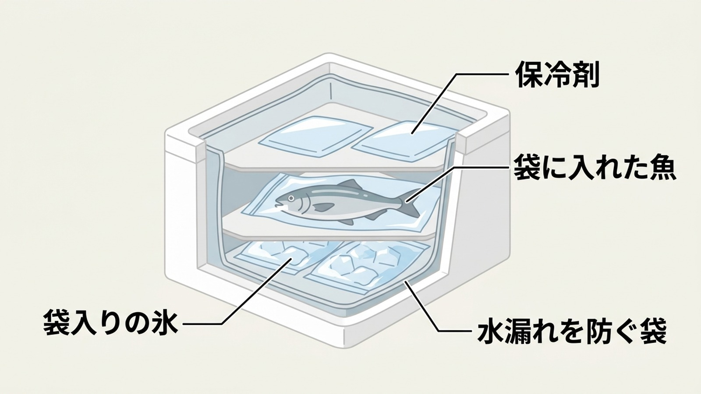
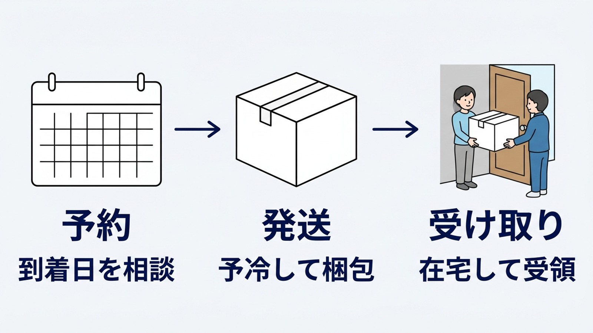

import TackleCard from "~/components/common/TackleCard.astro";

{/* cover prompt: High-end editorial photograph of a large fresh yellowtail sealed in a clear food bag being packed into a plain white insulated shipping box, separate sealed ice bags and plain blue ice packs, on a clean preparation table beside wooden pontoons and square fishing pens in a calm protected bay, soft cinematic morning light, realistic premium photography, exact 16:9 landscape, no text, no labels, no logos, no people. */}

遠征先でブリが釣れたあと、魚を抱えて駅や空港へ向かうのは大変です。帰りの移動だけでなく、どこでさばき、いつ食べるかまで先に決めると、旅の予定を組みやすくなります。

## 旅先で釣った魚は、3つの方法から選ぶ

| 選択肢 | 向いている予定 | 予約前に聞くこと |
| :--- | :--- | :--- |
| 現地でさばいてもらう | 持ち帰って家で調理したい | 三枚おろしまで可能か、待ち時間、料金、保冷容器 |
| 宿で料理してもらう | 旅先の夕食で食べたい | 持ち込みの可否、受付時刻、調理料、魚種・量の条件 |
| 家へ送る | 電車・飛行機で身軽に帰りたい | 梱包・予冷・発送の対応、到着予定日、箱の上限 |

さばいてもらっても、持ち帰る間の保冷は必要です。宿も、予約なしに釣魚を持ち込めるとは限りません。

<strong>魚の行き先→処理する場所→保冷と受け取りの順に決める</strong>のがおすすめです。配送を使うなら、帰宅前に魚だけ到着しない日程にします。

自分で運ぶ場合は、[遠征のクーラーボックスと運送規定](/column/travel/cooler-box-guide/)も確認してください。

## 配送方法は、施設の対応と箱の大きさで選ぶ

| 状況 | 選ぶ方法と注意点 |
| :--- | :--- |
| 施設に発泡スチロール宅配便セットがある | 箱・氷・梱包・発送のうち、含まれる作業を聞く |
| 施設にセットがない | 自分で箱を用意し、営業所の受付・予冷条件を先に確認する |
| 大物が規格内の箱に入らない | 現地で切り分けられるか、分梱できるかを相談する |
| 車で持ち帰れる | 魚と氷が入る容器を用意し、帰宅まで保冷する |
| 到着日に受け取れない | 釣行日か受け取り予定を調整する |

「宅配便セットあり」だけでは、締め・血抜き・三枚おろしまで含むとは分かりません。箱代・氷代・処理料・送料を分けて見積もってもらいましょう。

## クール便と通常便では、サイズの上限が違う

<strong>大きなクーラーを通常便で送れることと、魚を冷蔵便で送れることは別です。</strong>

次の規定は2026年11月9日に公式で確認しました。箱の外寸で測り、魚・氷・容器を含めた重量で判定します。

| サービス | 3辺合計の上限 | 重量の上限 | 用途の考え方 |
| :--- | :--- | :--- | :--- |
| ヤマト・クール宅急便 | 120cm | 15kg | 予冷した魚を冷蔵・冷凍で送る |
| 佐川・飛脚クール便 | 140cm | 30kg | 予冷した魚を送る。受付条件も確認する |
| ヤマト・通常の宅急便 | 200cm | 30kg | 空のクーラーなどの道具を送る場合に検討 |
| 佐川・飛脚ラージサイズ宅配便 | 260cm | 50kg | 大型の道具を送る場合に検討。クール便ではない |

出典：[ヤマトのクーラー発送FAQ](https://faq.kuronekoyamato.co.jp/app/answers/detail/a_id/2003/)、[佐川のクール料金・規格](https://www.sagawa-exp.co.jp/fare/attention.html)、[佐川の配送サービス](https://www.sagawa-exp.co.jp/customer/send/)。

ブリ一本を丸ごと入れる場合は、容量だけでなく箱の内寸も確認します。外寸が規格を超えるなら、保冷剤を減らして押し込む前に、切り分けと分梱を相談してください。

## 配送料は、基本運賃にクール料金などを足す

ヤマトのクール便は120サイズまでです。通常便のサイズ表を見ながら、魚を送る料金を計算しないようにしましょう。

[ヤマト公式のクール料金](https://www.kuronekoyamato.co.jp/ytc/customer/send/services/cool/)は、基本運賃に次の金額を加算します（2026年11月9日確認、税込）。

| サイズ | クールの追加料金 |
| :--- | ---: |
| 60 | 275円 |
| 80 | 330円 |
| 100 | 440円 |
| 120 | 715円 |

佐川は、140cm・20kgまでのクール追加料金が880円、140cm・30kgまでは1,320円です（[公式料金表](https://www.sagawa-exp.co.jp/fare/attention.html)、同日確認）。

<strong>合計は発送地・到着地・箱のサイズ・重量・箱数で変わります。</strong>基本運賃は各社の公式料金検索で調べ、施設の箱・氷・処理の費用を足してください。複数箱になる大物は、一箱分の送料だけで予算を決めないようにします。

## 梱包のコツは、予冷・水漏れ防止・保冷材の配置

発送窓口に持ち込んでから魚を冷やしてもらう前提では、受け付けてもらえないことがあります。

クール便は温度を保って運ぶサービスで、温かい魚を冷やすサービスではありません。ヤマトは冷蔵の予冷を<strong>10℃以下で6時間以上</strong>と案内しています。釣り終了後の当日発送ができるか、施設の保冷設備と集荷時刻を予約時に照合してください。

[ヤマトの予冷案内](https://faq.kuronekoyamato.co.jp/app/answers/detail/a_id/1322/)と[魚介類の梱包手順](https://www.kuronekoyamato.co.jp/ytc/customer/send/preparations/packing/cool/fish/)を2026年11月9日に確認しました。

1. 現地で処理を済ませ、魚を予冷する。対応する作業は施設ごとに確認する。
2. 魚と氷はそれぞれ袋へ入れ、溶け水や魚の水分が外へ漏れないようにする。
3. 発泡スチロール内にも保冷剤を入れ、ふたを閉じて実寸と総重量を確認する。

{/* fig-01 prompt --diagram: Explanatory cutaway diagram of a white insulated fish shipping box. Bottom layer contains sealed bags of ice, middle layer a fish inside a separate sealed bag, top layer plain ice packs. Leader lines point precisely to each layer and the inner liner. Use only these Japanese labels copied exactly: 「保冷剤」「袋に入れた魚」「袋入りの氷」「水漏れを防ぐ袋」. Light background, clean simple flat illustration, generous readable type, exact 16:9 composition. No other text. */}

図は配置の一例です。氷の量や上下の配置は箱・魚・運送会社の案内に合わせます。箱の断熱材は外の冷気も通しにくいため、内部の保冷を省けません。

### 自分で梱包するなら、保冷剤を凍らせる場所も決める

旅先で保冷剤を買っても、発送までに凍らせられなければ役立ちません。持参するなら、出発前の凍結と宿の冷凍設備の利用可否を確認します。

選ぶ基準は<strong>箱に収まる外寸、完全に凍結させられる準備時間、魚と合わせた総重量</strong>です。[LOGOS公式](https://www.logos.ne.jp/products/info/944)で凍結条件とサイズを確認し、準備できる人は次の保冷剤も候補にできます（2026年11月9日確認）。

<TackleCard id="tackle/logos-hyotenka-pack" placement="travel-shipping" reason="発泡スチロールで魚を送るときの内部保冷用。箱の余白と重量上限を確かめ、現地で凍結済みの状態を用意できる場合に選ぶ候補です。" />

宿で凍結できない人や一度だけの遠征なら、施設に箱と氷を手配してもらうほうが段取りを減らせます。

## 受け取りの落とし穴は、帰宅より先に魚が届くこと

クール便を出せても、届く日に不在では予定どおり料理できません。予約時から発送日と受け取り日をセットで決めます。

{/* fig-02 prompt --diagram: Simple clean left-to-right three-step flow on light background. First icon is a completely blank calendar with no symbols or numbers. Second icon is a completely blank closed white shipping box, absolutely no writing on box faces. Third icon is two people receiving a completely blank box at a home doorway. Connect icons with arrows. Render ONLY these six Japanese text strings exactly: 「予約」「到着日を相談」「発送」「予冷して梱包」「受け取り」「在宅して受領」. Put the first two under the calendar, the next two under the box, the last two under the receiving scene. No additional Japanese, no fresh food label, no marking, no letters. Large legible navy type. Exact 16:9 landscape. */}

- 在宅する日時に合わせ、利用できるお届け日・時間帯を窓口に確認する。
- 営業所受け取りなら、対応営業所と営業時間を確認する。
- ヤマトのクール宅急便はコンビニ受け取りに対応していない。
- 受け取ったら保冷状態を確かめ、処理・調理の予定へ移る。

[ヤマト公式](https://www.kuronekoyamato.co.jp/ytc/customer/send/services/cool/)では、翌日配達地域は発送から最大3日先、翌々日配達地域は最大4日先までお届け日を指定できます（2026年11月9日確認）。これは魚の保存可能日数を示す規定ではありません。不要に到着を先延ばししないようにします。

### 年末は、指定日の確認と遅延の確認を分ける

年末年始は道路の混雑や天候で配送が遅れる場合があります。[ヤマトの2025年末の案内](https://business.kuronekoyamato.co.jp/service/lineup/business_members/update/pdf/YBM_2025121901.pdf)でも遅延の可能性を告知しています。

これは昨季の案内です。2026〜2027年の特別日程の根拠にはせず、出発前に[現行のお知らせ・遅延情報](https://www.kuronekoyamato.co.jp/ytc/customer/)と営業所の受付時間を確認してください（2026年11月9日確認）。

<strong>到着当日の宴席に間に合う前提で発送しない</strong>ことも大切です。冷凍で送る計画なら解凍の時間も含め、施設と運送会社へ相談しましょう。

## 冬の大物は、一本をどう分けて食べるかまで考える

ブリなどの大物は、箱に収めるための切り分けと、帰宅後の料理を一緒に考えると無駄が減ります。処理できる場所、魚の量、受け取れる日を先に決めてください。

筆者のブリの記録では、家庭で寝かせるのは<strong>翌日、長くても2日まで</strong>です。これは保冷状態を問わず保存できる期限ではなく、発送日数にそのまま足せる日数でもありません。家庭の冷蔵庫で長期間の低温熟成は勧めません。

鍋とほかの料理への食べ分けは、[冬の大物を釣って鍋にする計画](/column/trivia/winter-big-fish-nabe/)にまとめています。

## 配送準備のチェックリスト

- [ ] 予約時に箱・氷・処理・予冷・発送の対応範囲を確認する。
- [ ] 大物は切り分けの可否、箱の内寸と総重量、箱数を確認する。
- [ ] 基本運賃・クール料金・施設でかかる費用を分けて見積もる。
- [ ] 発送日・到着予定日・在宅日時を合わせる。
- [ ] 年末は受付時間と直近の遅延情報を確認する。

## 関連ページ

- [遠征のクーラーボックスと運送規定](/column/travel/cooler-box-guide/)：持参・現地購入・配送の選択。
- [遠征釣行ガイド](/column/travel/access/ensei-guide/)：移動と前泊の準備。
- [はじめての海上釣り堀](/tactics/beginner/first-fishing-pond/)：予約と当日の流れ。
