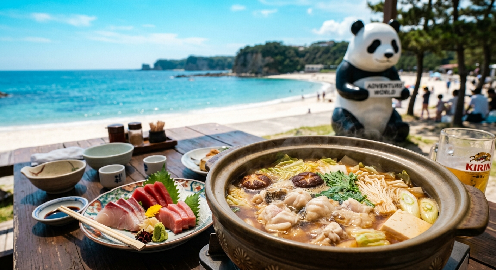

import AffiliateCard from "~/components/common/AffiliateCard.astro";

紀伊半島の南紀白浜は、釣りと温泉、海の幸を組み合わせて過ごせる旅先です。

冬なら、夕食のクエ鍋を目的にする旅と、釣った魚を家の鍋へ持ち帰る旅を分けて考えると、予約先を選びやすくなります。

私なら、釣りの集合地と夕食の時刻を決めてから宿を探します。釣果がなくても、温泉と料理を楽しめる予定にしたいからです。

営業・料金は2026年11月15日に公式で確認しました。今季の告知と通常案内を区別して掲載しています。

車・特急の利用は、[近畿・関西アクセスガイド](/column/travel/access/access-kinki)も参考にしてください。

## このガイドが向いている人

| あなたの状況 | 読むところ |
| :--- | :--- |
| 白浜に初めて家族で行く | 施設比較とモデルプラン |
| クエ料理と釣りを一緒に楽しみたい | グルメと冬の鍋の段取り |
| 温泉宿に泊まりたい | 温泉と宿泊先の選び方 |
| 大阪方面からの立ち寄りを考えている | 紀州・マリーナシティの所在地の違い |
| 釣り初心者で道具がない | [初めての海上釣り堀ガイド](/tactics/beginner/first-fishing-pond) |

## 白浜と、北側の立ち寄り候補を比較

<strong>釣堀紀州は広川町、マリーナシティは海南市</strong>です。3施設とも白浜にあるわけではないので、同じ宿から通う候補として並べないようにします。

| 施設 | 位置づけ | 予定の立て方 |
| :--- | :--- | :--- |
| [カタタの釣堀](/fishing-facility/kakata-fishing-pond/) | 白浜町の海上釣り堀 | 白浜泊と組み合わせる主な候補 |
| [釣堀紀州](/fishing-facility/tsuribori-kishu/) | 広川町の渡船で行く海上釣り堀 | 白浜へ向かう日・帰る日の別行程として検討 |
| [和歌山マリーナシティ釣り公園](/fishing-facility/wakayama-marinacity-fishing-park/) | 海南市の釣り公園 | 帰路の候補。放流型の釣り堀とは区別 |

所在地と利用形態の出典：[カタタ公式](https://toretore.com/tsuri/access.html)・[紀州公式アクセス](https://www.tsuribori-kishu.com/access/)・[マリーナシティ公式](https://www.marinacity.com/tsuri/)（2026年11月15日確認）。

マリーナシティは11月の休園案内を確認しましたが、今季の冬の日別営業は未確認です。12〜2月の立ち寄りを決める前に公式で確認してください。

### カタタの釣堀の冬時間と通常料金

| 項目 | 公式の通常案内 |
| :--- | :--- |
| 12月〜2月の営業時間 | 7:30〜14:00 |
| 同期間の受付 | 大物の釣座抽選は7:00まで。小物コースは随時受付 |
| 大物釣り | 大人12,400円、女性9,200円、小学生以下7,100円 |
| 小物釣り | 1名2時間3,680円、竿・エサ込み |
| 持ち帰り | 釣った魚は全て持ち帰り可 |
| 通常の休業案内 | 年中無休、悪天候時は休業あり |

出典：[カタタの料金・利用案内](https://www.toretore.com/tsuri/price.html)・[営業時間](https://toretore.com/tsuri/access.html)（2026年11月15日確認）。

大物コースの道具代など、入場料以外に必要な費用は予約時に確認しましょう。

年末年始は営業日が変わるので、予約前に公式で確かめてください。年間の「年中無休」の案内を今季の個別告知としては扱いません。

### 釣堀紀州の年末年始は今季の告知を確認

[今季の公式告知](https://www.tsuribori-kishu.com/年末年始の営業・料金についてのお知らせ-2/)と添付カレンダーを確認しました（2026年11月15日確認）。

| 今季の日程 | 公式告知の内容 |
| :--- | :--- |
| 2026年12月31日まで | 年末営業。途中の休業日はカレンダーを確認 |
| 2027年1月1日〜2日 | 休業 |
| 2027年1月3日 | 営業再開 |
| 2026年12月25日・2027年1月5日〜6日 | 臨時休業 |
| 2026年12月26日〜31日 | 竿を出す人は通常の釣り代に年末利用料2,000円を追加 |

12月22日は定休日として掲載されています。年末の期間を毎日営業と読み替えないでください。

通常の一般イケス料金は男性13,750円、女性10,450円、小学生以下6,050円。税込・渡船料込みです。

一般受付は7:00から、釣りは8:00頃から5時間が目安。渡船や天候で変わるため、午後の予定を固定しすぎないようにします。

出典：[紀州の料金・営業時間](https://www.tsuribori-kishu.com/料金・営業時間/)（2026年11月15日確認）。貸切は条件が異なります。

## おすすめの1泊2日モデルプラン

| 時間帯 | 1日目：白浜で釣りと温泉 | 2日目：動物や海の風景を楽しむ |
| :--- | :--- | :--- |
| 早朝 | カタタの冬の受付に合わせる | 朝食と魚の保冷・荷物を確認 |
| 午前 | 予約したコースで釣り | アドベンチャーワールド、または海辺の観光 |
| 昼 | 魚の受け取り・処理後に食事 | 営業を確認した店で昼食 |
| 午後 | 温泉へ。釣魚を持つ場合は保管方法を先に相談 | 三段壁洞窟など、天候に合う場所を選ぶ |
| 夕方 | 予約したクエ料理、または了承を得た宿で釣魚料理 | 魚を持つ場合は寄り道を増やさず帰路へ |

これは旅程の提案です。釣りの開始前に遠方から到着するのが難しければ、前泊を加えるか、初日を移動・観光の日に入れ替えましょう。

釣堀紀州を選ぶ場合は、広川町での釣りと白浜への移動を組み直します。

<strong>冬は水温で魚の食いが落ちます。</strong> 温泉と夕食の予約を、釣れることを条件に組まないのが大切です。

## グルメ：白浜で楽しみたいクエ料理と海鮮

### 冬のクエ鍋は、料理を予約して楽しむ案も

クエ鍋を冬旅の夕食に据えるなら、釣りとは別に料理プランを予約しておく方法があります。

三重・和歌山では、養殖クエも冬の鍋を楽しむ選択肢です。天然か養殖かを確かめて料理を選び、釣り場で出会える魚とは分けて考えましょう。

[南紀白浜観光協会のクエ料理案内](https://www.nankishirahama.jp/feature/7568/)には店の一覧がありますが、入荷は事前確認が必要です（2026年11月15日確認）。

料理の料金・提供期間・予約期限は店ごとに公式で確認し、実際のプランを比較してください。

天然か養殖か、鍋以外に何が付くか、子供の食事は別に頼めるかを確認すると選びやすくなります。

また、紀州で案内されることがある「タマクエ」を「クエ」と書き換えて注文や釣果の話をしないようにしましょう。

### とれとれ市場の海鮮

昼食や土産探しには、とれとれ市場を組み合わせる案があります。

食事の内容と価格、各売り場の営業時間・休業は[とれとれ市場の公式案内](https://toretore.com/ichiba/)で確認してください（2026年11月15日確認）。

食事は各店舗のメニューと営業を確認し、釣りの終了に合わせて利用できる店を選びましょう。

### 釣った魚は宿や家の鍋へ

カタタは釣魚の持ち帰りを公式に案内していますが、その魚をどの宿でも調理してもらえるわけではありません。

宿には魚種・サイズ・数・到着時刻を伝え、持ち込み調理の可否、料金、処理条件を先に確認してください。

受け入れがない場合は、家で鍋にする段取りを選びます。観光中や宿泊中の保冷をどう続けるかも決めておきましょう。

魚を持ち帰る準備と鍋の考え方は、[冬の大物を鍋にする楽しみ](/column/trivia/winter-big-fish-nabe)にまとめています。

釣り堀のブリは養殖魚が中心なので、天然の寒ブリと同じ意味で呼ばず、釣った魚として料理を考えてください。

## 観光：白浜で立ち寄る2か所

### アドベンチャーワールド

サファリワールドやマリンワールドを楽しむ候補です。冬の営業時間に合わせて、観覧したいエリアを選びましょう。

4頭のジャイアントパンダは2025年6月28日に中国へ帰国しています。[公式発表](https://www.aws-s.com/topics/detail?id=top4272)を確認しました（2026年11月15日確認）。

[公式案内](https://www.aws-s.com/)の1日入園券は大人5,300円、シニア4,800円、中人4,300円、小人3,300円です（2026年11月15日確認）。

営業時間・休園日・対象年齢・追加料金のある体験は公式カレンダーと料金案内で確認してください。釣りの後に毎日18時まで入れるとは考えず、別日に余裕を取る案が向いています。

### 三段壁洞窟

洞窟から海の風景を楽しむ観光候補です。[公式案内](https://sandanbeki.com/)は8:00〜17:00、最終入場16:50としています（2026年11月15日確認）。

[今季の休館告知](https://sandanbeki.com/news/detail.php?id=77)では、2026年12月8日〜11日は館内総点検で休館です（同日確認）。

入場料金と当日の営業は公式で確認してください。強い風の日に、釣りの代わりとして必ず入れる場所とは決めつけません。

## 白浜の宿泊先選び

宿を選ぶときは、釣り場までの経路と夕食の条件を先に見ます。

| 重視すること | 確認する条件 |
| :--- | :--- |
| カタタの早朝受付 | 受付場所までの経路、早朝出発、朝食の扱い |
| クエ料理 | 提供する魚と料理内容、料金、事前予約の期限 |
| 釣魚を宿で食べる | 持ち込みの了承、受け入れ時間、下処理と追加費用 |
| 翌日の観光 | チェックアウト後に魚をどう保冷するか |

日帰り温泉の候補として、カタタの湯は通常8:00〜22:00、最終入場21:00。大人680円、12歳以下480円、2歳以下無料と案内しています。

出典：[カタタの湯公式](https://toretore.com/tei/katata.html)（2026年11月15日確認）。旅行日の利用可否は直前に確認してください。

早朝の釣りと温泉、夕食のクエ料理を組み合わせるなら、白浜に泊まる宿を比較すると予定を合わせやすくなります。

<AffiliateCard id="travel/rakuten-travel" isVertical={true} placement="travel-shirahama-stay"
  reason="カタタの冬の早朝受付と、温泉・クエ料理の夕食を組み合わせる旅へ。集合地までの経路と料理プランを比べて白浜の宿を探す入口です。釣魚の持ち込みは直接相談してください。"
  ctaLabel="白浜の温泉・宿泊プランを探す" />

前泊や移動費の考え方は[遠征釣行ガイド](/column/travel/access/ensei-guide)も参考にしてください。

## よくある質問（FAQ）

<strong>Q1. 電車で白浜へ行けますか？</strong>

鉄道利用も候補ですが、時刻表と駅からの移動を確認してください。早朝の釣りには前泊が必要か、魚や荷物を運べるかも合わせて考えます。

<strong>Q2. 動物の観覧と釣りを1日で楽しめますか？</strong>

釣りの終了や魚の受け取りが延びる場合もあるため、観光を翌日に分けると予定を組みやすくなります。

<strong>Q3. 大阪から日帰りするなら？</strong>

白浜までの往復と集合時間を先に調べます。広川町の釣堀紀州も別の行き先として比較できますが、白浜近郊の施設ではありません。

<strong>Q4. クエ料理は釣れた魚で用意できますか？</strong>

釣果や宿の受け入れを前提にせず、料理プランの予約と持ち込み調理を分けて相談してください。

<strong>Q5. 子供向けに道具を借りられますか？</strong>

カタタは小物コースに竿・エサが含まれます。大物コースや紀州は、子供が扱う道具とレンタルの条件を予約時に確認してください。

## 関連ページ

- [冬に行きたい太平洋側の海上釣り堀](/column/trivia/winter-kaijo-tsuribori-pacific)
- [冬の大物を鍋にする楽しみ](/column/trivia/winter-big-fish-nabe)
- [近畿・関西アクセスガイド](/column/travel/access/access-kinki)
- [カタタの釣堀](/fishing-facility/kakata-fishing-pond/)
- [釣堀紀州](/fishing-facility/tsuribori-kishu/)
- [和歌山マリーナシティ釣り公園](/fishing-facility/wakayama-marinacity-fishing-park/)
