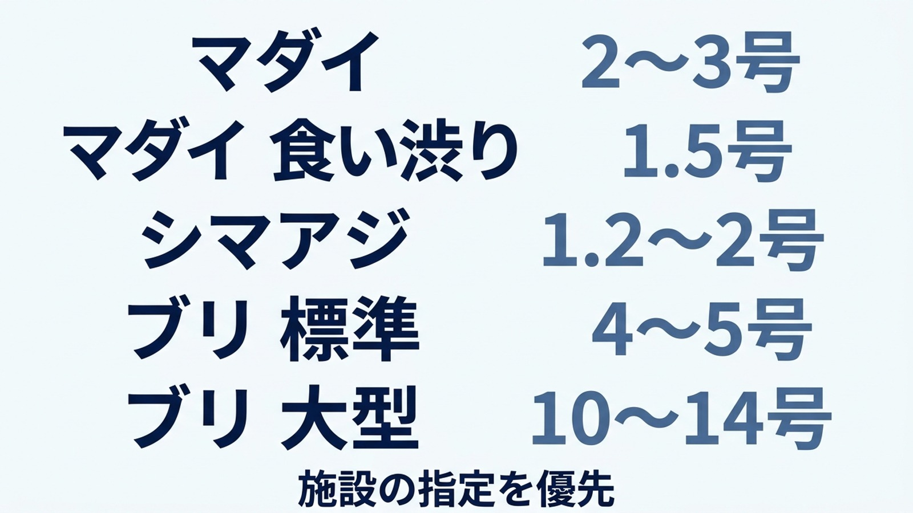
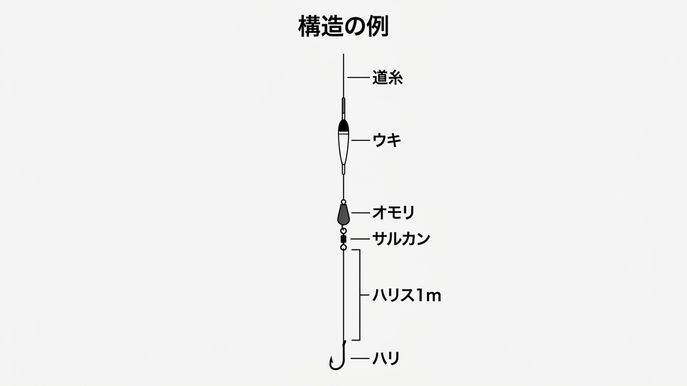

---
title: "海上釣り堀のハリスの選び方｜魚種別の号数・長さ・素材を決める順番"
category: "タックル紹介"
tags: ["ハリス", "海上釣り堀", "フロロカーボン", "仕掛け", "ライン"]
publishDate: "2026-03-22"
lastmod: 2026-11-09
image: ./cover.jpg
description: "海上釣り堀でマダイ・シマアジ・ブリを狙うハリスの選び方。施設の決まり、魚種とサイズ、エサの動き、竿とドラグを順に確認し、号数と長さを決めます。魚種資料の数値の前提を分け、食い渋りで細くする前の見直し、傷の確認、交換用の仕掛けの準備も紹介します。"
---

import TackleCard from "~/components/common/TackleCard.astro";

{/* cover prompt: Hyper-realistic editorial macro photograph of a single polished sea fishing hook and a neat coil of clear fluorocarbon leader lying beside each other on dry wood. The hook and coil are separate, no knot, no connection diagram. Plain unbranded spool blurred at left, floating square fishing pens on a calm protected bay softly out of focus behind. Clean premium cinematic closeup, precise realistic single hook anatomy, soft side light highlights transparent filament. Exact 16:9 landscape composition. No text, no numbers, no logos, no people. */}

マダイを狙う仕掛けのまま、ブリも狙うか。それとも、エサの前で魚が止まるのでハリスを細くするか。

釣り場で迷うのは、糸の太さだけではありません。ハリスの長さ、素材、竿の適合範囲、ドラグまでつながっています。

<strong>施設の決まり→狙う魚とサイズ→仕掛け全体のバランス</strong>の順に決めると、買う号数を絞れます。

ハリスは、仕掛けの先端でハリを結ぶ糸です。リールに巻く道糸とは役割を分けて考えます。

## 最初に、施設の仕掛けと持ち込みルールを確認する

受付で完成仕掛けを買う予定なら、針や糸を先に買いそろえる必要がない場合もあります。

反対に、自分で仕掛けを組むなら、使える素材・号数・ハリの決まりを聞いておきましょう。

魚種別の表は施設の規定に優先しません。魚の大きさや混み方でも、現地が勧める仕掛けは変わります。

| 予約・受付で聞くこと | 決めるもの |
| :--- | :--- |
| 狙う魚の種類とサイズ | ハリスとハリの候補 |
| ハリスの号数・素材に指定があるか | 持ち込める糸 |
| レンタルに仕掛けが含まれるか | 自分で用意する範囲 |
| 当日のタナと網底の形 | ウキ下と仕掛けの扱い方 |

## 魚種別の号数は、釣り方の前提と一緒に見る

以下はサイトの魚種資料にある既存攻略の目安です。実釣で一律に確かめた数値ではなく、魚のサイズや釣法によって幅があります。

<strong>細いほどよい、太いほど安心、と一方向には決まりません。</strong>

| 魚種・場面 | ハリスの号数 | 読み方 |
| :--- | :--- | :--- |
| マダイの標準 | 2〜3号 | まず現地の推奨と照合する |
| マダイの食い渋り | 1.5号 | タナやエサを見直した後の選択肢 |
| シマアジ | 1.2〜2号 | 釣法による幅があり、細仕掛けはやり取りも合わせる |
| ブリの標準として既存攻略で扱う範囲 | 4〜5号 | 大型向けの基準と混同しない |
| 大型ブリ狙いの別設定 | 10〜14号 | 同じブリでも前提が異なる。施設にサイズと仕掛けを相談する |

出所はマダイ・シマアジ・ブリの魚種別資料の「ハリス・針」です。ブリとシマアジには攻略記事間の幅が残るため、平均を作らずに示しています。

{/* fig-01 prompt --diagram: Japanese fishing leader reference chart, five horizontal rows with ample whitespace. Use ONLY these exact labels, in corresponding row pairs: 「マダイ」「2〜3号」, 「マダイ 食い渋り」「1.5号」, 「シマアジ」「1.2〜2号」, 「ブリ 標準」「4〜5号」, 「ブリ 大型」「10〜14号」. Footer only 「施設の指定を優先」. Do not add any other text. Light background, clean navy and muted blue flat diagram, large legible Japanese text, exact 16:9 composition. */}

### マダイは、タナを合わせてから細くする

隣ではアタリが出るのに自分のウキが動かないと、ハリスを替えたくなります。

ただし、エサが魚のいる深さを通っていなければ、太さだけを変えても原因は残ります。

マダイ攻略では、まず底を取り、反応のあるタナへ合わせる考え方を扱っています。

食い渋りの細ハリスはその後の選択肢です。細くしたときはドラグも見直し、掛けた魚を強く引きすぎないようにします。

釣り方は[マダイの基本攻略](/tactics/fish-strategy/madai/)を参照してください。

### シマアジは、エサの動きと口切れを一緒に考える

シマアジの魚種資料では、エサを吸い込むときの糸の張りや、強いやり取りによる口切れが課題として整理されています。

目がよい魚として、見えている個体を狙う方法も扱われています。

ただし、見えにくい糸に替えれば食うとは言えません。ハリの重さやエサの大きさ、糸を張りすぎていないかも確かめます。

掛かった後に切れる・外れる場面では、太さを変えるだけでなく、竿とドラグの受け方を見直してください。

[シマアジ攻略](/tactics/fish-strategy/shimaji/)では、ウキ釣りと細かなアタリの取り方を扱っています。

### ブリは、標準と大型用を分けて用意する

マダイ用の細いハリスのまま、大型ブリにも対応できると考えるのは無理があります。

ブリの資料には標準の4〜5号と、大型狙いの10〜14号という別の設定があります。どちらかを全施設共通の正解にはしません。

狙うサイズを聞き、竿の適合ハリス、道糸の強さ、ドラグまで一緒に合わせましょう。

号数を太くしても、ドラグを固定して強く引けば切れる原因は残ります。

大型狙いの準備は[ブリ攻略](/tactics/fish-strategy/buri/)につなげて確認できます。

## 素材は、扱いやすさとエサの動きから選ぶ

フロロカーボンはハリスの候補になります。ここで考えたいのは、「水中で見えない」と言い切れるかではなく、選んだ号数の糸を結び、エサを動かしやすいかです。

太くすると結びやすさや張りの感じも変わります。同じ素材名でも製品ごとの仕様を見て選びます。

### 自分で結び替える人には、しなやかさも選ぶ条件になる

釣り場でハリスに傷を見つけ、ハリを結び直す場面を考えてください。

狙う魚に合う号数でも、結び目が締まりきらず糸が傷んでいれば、そのまま使い続けられません。

選ぶ条件は、<strong>必要な号数があり、自分で結びを整えやすい糸質であること</strong>です。糸の強さだけで魚を取り込むのではなく、竿とドラグに負荷を受けてもらいます。

[シーガー公式](https://www.seaguar.ne.jp/lineup/fcharisu/fc_5.html)では、グランドマックスFXをしなやかさを加えたフロロカーボンハリスと案内しています（2026年11月9日確認）。その条件で選ぶ製品の一つです。

<TackleCard id="tackle/seaguar-grandmax-fx" placement="gear-harris" reason="マダイ用とブリ用を自分で結び分ける人へ。必要な号数を選び、しなやかな糸質も比較したいときのフロロハリスの候補です。" />

自分でハリを結ぶ準備がない人は、現地の完成仕掛けやレンタルを選ぶと、太さとハリの組み合わせを相談できます。

## ハリスの長さとウキ下は、別に考える

ハリスを長くした分だけ魚のいるタナへ届く、という決め方はしません。

ウキ釣りではウキからハリまでの深さと、道糸につながるハリス部分の長さを分けて確認します。

下図は<strong>ハリス部分を1mとして描いた構造説明用の例</strong>です。全魚種に共通する推奨の長さではありません。

{/* fig-02 prompt --diagram: Simple vertical fishing float rig diagram on a light background, arranged in the middle with ample whitespace on both sides. Continuous main line descends past one correctly attached slender float and a sinker to a small swivel. A separate leader continues from the swivel to one single hook. Draw a dimension bracket ONLY from the swivel to the hook and label it 「ハリス 1m」. Other exact labels only 「道糸」「ウキ」「オモリ」「サルカン」「ハリ」「構造の例」. Put each leader line at the correct object, not touching dimension bracket. Exact 16:9 landscape. No other text. */}

### シマアジの短いハリスは、釣法の条件とセット

シマアジ資料のミャク釣りでは、ハリス40〜60cmの例があります。

これは糸の変化でアタリを取る釣法の設定です。ウキ釣り全体の標準として置き換えないようにします。

短い設定へ変えるときは、エサの沈み方や張り方も変わるので、長さだけを切り取ってまねないことが大切です。

## 魚が食わない理由を、ハリス一本で説明しない

水温が下がった日、魚が食べる量そのものが減っていることがあります。

マダイの魚種資料では、低水温で代謝が落ち、食べる量が減ると整理されています。

この場面で細いハリスに替えても、魚の食欲を強制的に変えられるわけではありません。

<strong>タナ、エサの状態、糸の張り、周囲の反応</strong>を順に確かめ、一度にすべてを替えずに比べましょう。

反応が出たら、そのタナと仕掛けの組み合わせを覚えておくと、元へ戻して比較できます。

## 交換する前後に見るところ

| 場面 | 確かめること |
| :--- | :--- |
| 仕掛けを投入する前 | 結び目が締まり、ハリスに折れや傷がないか |
| 網際を通った後 | 表面に傷が疑われないか。疑わしければ交換する |
| 魚が掛かった後 | 切れたのか、ハリが外れたのかを分ける |
| 細い号数へ替えたとき | ドラグが強すぎないか |
| 大型魚へ狙いを替えるとき | 竿・道糸・ハリまで対応しているか |

交換用は、魚種と号数が分かるように分けて持つと、釣り場で迷いにくくなります。

ハリスを決める出発点は、現地の条件と狙う魚です。必要な仕掛けを絞って用意し、当日は魚の反応と糸の状態を見ながら調整してください。
